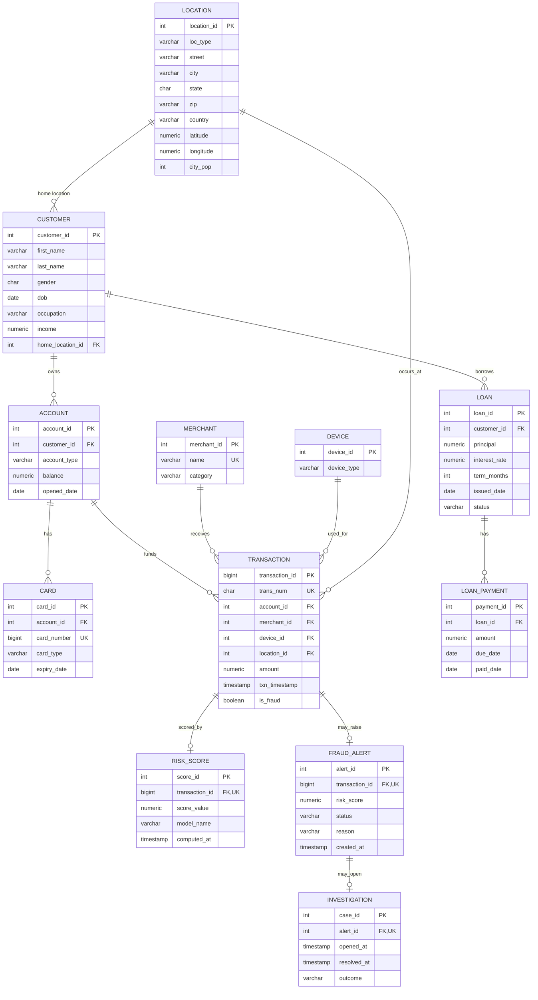

# FinGuard AI ER diagram

The diagram below follows the 12 base tables and foreign keys defined in `schema.sql`. Investigation resolution time is stored in `investigation.resolved_at`; the advanced SQL installs the trigger that maintains it alongside the linked alert status.

The `transaction_id` columns in `RISK_SCORE` and `FRAUD_ALERT`, and the `alert_id` in `INVESTIGATION`, are both foreign keys and unique in the schema. This makes each relationship optional one-to-one rather than one-to-many.
