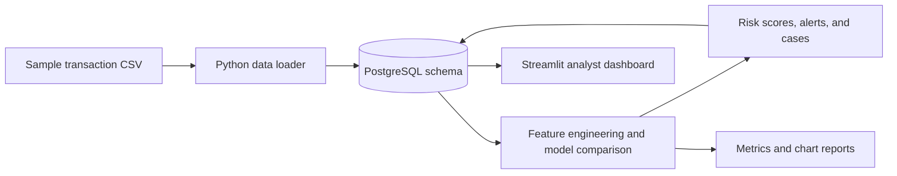

# FinGuard AI

**FinGuard AI** is an end-to-end fraud analytics project built with PostgreSQL, Python, scikit-learn, and Streamlit. It turns a transaction sample into a relational database, compares fraud-scoring models, stores risk scores and investigation cases, and gives an analyst a dashboard to explore and review the results.

The included sample has **10,000 transactions**, including **700 dataset-labeled fraud transactions (7.00%)**. Model reports and charts are generated files; rerun the pipeline after setup to refresh them with the current code.

## Project highlights

- **Relational design:** 12 PostgreSQL tables with primary keys, foreign keys, domain constraints, indexes, views, a function, and an investigation trigger.
- **Fraud scoring:** Logistic Regression, Random Forest, and Isolation Forest compared with validation PR-AUC; the refreshed Random Forest report records 0.948 validation PR-AUC and 0.962 held-out test PR-AUC on this sample.
- **Investigation workflow:** risk scores create model alerts and high-risk cases; resolving a case updates its linked alert in the database.
- **Analyst dashboard:** sample-date presets and custom date ranges, category and alert filters, transaction search, customer profiles, a pending-case workflow, model reports, and CSV export.
- **Reproducible sample data:** the loader uses a fixed random seed for generated account, device, and loan fields.

## Data flow



## Analytics preview

These charts show recorded sample labels by category and hour. They describe the dataset, not a live fraud feed.


## Portfolio summary

> Built FinGuard AI, a PostgreSQL-backed fraud analytics project that models transaction risk and supports case review. Designed a 12-table relational schema with constraints, indexes, views, a SQL function, and a trigger; implemented a reproducible Python pipeline to compare supervised and unsupervised models; and built a Streamlit dashboard for transaction exploration, investigation outcomes, customer risk profiles, and CSV exports. The refreshed Random Forest report achieved 0.948 validation PR-AUC and 0.962 PR-AUC on a separate held-out test split of the 10,000-row sample.

The reports in `outputs/` were refreshed on 2026-10-21 using the current evaluation code; the report-only mode leaves database scores, alerts, and investigations unchanged. The local PowerPoint draft is excluded from GitHub until its screenshot placeholders are resolved. This is a prototype evaluated on one sample dataset, not a production fraud prevention system.

## Dataset and scope

The included 10,000-row CSV is a sample from the [Credit Card Transactions Fraud Detection dataset on Kaggle](https://www.kaggle.com/datasets/kartik2112/fraud-detection), generated with the [Sparkov Data Generation tool](https://github.com/namebrandon/Sparkov_Data_Generation). The source dataset is simulated; its card numbers and identity fields are synthetic. This project uses the sample for coursework and demonstration, and the reported metrics should not be read as expected real-world fraud performance. The project code is MIT licensed; the dataset remains subject to its source terms.

## Tech stack

- PostgreSQL for relational storage, constraints, indexes, views, a function, and a trigger.
- Python with pandas, NumPy, scikit-learn, SQLAlchemy, and psycopg2 for loading and ML.
- Matplotlib for saved model and fraud-analysis charts.
- Streamlit for the interactive dashboard.
- SQL and Mermaid for the database demonstrations and ER diagram.

The Streamlit dashboard separates dataset labels from model-generated alerts so the charts and queue are easier to interpret. It includes a risk-score distribution, searchable transaction results, read-only resolved-case history, per-customer summaries, and model evaluation reports. Case updates require confirmation and refresh the queue automatically.

## Folder structure

```text
dbms/
├── .gitattributes
├── .gitignore
├── advanced_db.sql
├── dashboard.py
├── ER_DIAGRAM.md
├── FACULTY_QA.md
├── LICENSE
├── load_data.py
├── ml_pipeline.py
├── outputs/
│   ├── confusion_matrix_IsolationForest.png
│   ├── confusion_matrix_LogisticRegression.png
│   ├── confusion_matrix_RandomForest.png
│   ├── feature_importance.png
│   ├── fraud_by_category.png
│   ├── fraud_by_hour.png
│   ├── model_results.csv
│   ├── precision_recall_curve.png
│   ├── roc_curve.png
│   └── top_features.csv
├── queries.sql
├── requirements.txt
├── schema.sql
└── sparkov_sample_10000.csv
```

`load_data.py` reads `sparkov_sample_10000.csv` from the project directory, even when the script is launched from another working directory.

## Setup

### 1. Install and start PostgreSQL

Install PostgreSQL for Windows from the official PostgreSQL download page and start the PostgreSQL service. Create a database named `finguard` using pgAdmin or `psql`, for example:

```sql
CREATE DATABASE finguard;
```

### 2. Configure credentials and connection settings

All scripts accept `PGPASSWORD` as the shared PostgreSQL password. The dashboard and ML pipeline also accept `DB_PASSWORD` for compatibility with earlier setup. Set `PGPASSWORD` using Windows **Environment Variables**, then open a new terminal/VS Code window so it sees the updated value. No password is embedded in the source. Do not commit passwords or place them in this README.

Optional connection variables used by the scripts are `PGHOST` (default `localhost`), `PGPORT` (default `5432`), `PGDATABASE` (default `finguard`), and `PGUSER` (default `postgres`). Configure these consistently for all scripts if your local PostgreSQL settings differ.

### 3. Create a Python environment and install packages

From the project folder in PowerShell:

```powershell
py -m venv .venv
.\.venv\Scripts\Activate.ps1
python -m pip install -r requirements.txt
```

If PowerShell blocks environment activation, use the environment's Python directly, for example:

```powershell
.\.venv\Scripts\python.exe -m pip install -r requirements.txt
```

### 4. Load the dataset

Run this from the project folder:

```powershell
python load_data.py
```

This reads the sample CSV and creates/populates the schema. **Warning:** `schema.sql`, which the loader executes, drops and recreates the existing project tables and views. Running the loader again replaces those tables and their data, including scores, alerts, investigations, and advanced database objects; it is not a non-destructive refresh.

### 5. Train models and write scores

```powershell
python ml_pipeline.py
```

The script uses stratified 60/20/20 train, validation, and test splits. It selects a model by validation PR-AUC, refits each candidate on train plus validation data, and reports final comparison metrics on the untouched test split. By default, it writes risk scores, alerts, and investigations; selected supervised-model database scores use five-fold stratified out-of-fold probabilities. Charts and CSV reports are saved under `outputs/`.

To refresh only the evaluation CSVs and charts while leaving the database's risk scores, alerts, and investigation cases unchanged, run:

```powershell
python ml_pipeline.py --reports-only
```

### 6. Create the advanced SQL objects and run demonstrations

Using `psql` from the project folder:

```powershell
psql -U postgres -d finguard -f advanced_db.sql
```

Alternatively, open `advanced_db.sql` in pgAdmin's Query Tool and execute its statements in order. The script creates indexes (some names already exist in the base schema), `v_high_risk_transactions`, `v_customer_risk_summary_advanced`, `get_customer_risk()`, a resolution timestamp column, and an investigation trigger. Its trigger-test update is rolled back at the end. The transaction examples use a temporary table.

### 7. Start the dashboard

```powershell
streamlit run dashboard.py
```

The local dashboard URL printed by Streamlit is normally `http://localhost:8501`. The advanced SQL objects should be installed first because the dashboard queries the high-risk view and customer-risk function.

## Demo walkthrough

1. Show the populated database using the row-count query in `queries.sql` and point out the customer, account, merchant, transaction, and loan entities.
2. Run `SELECT * FROM v_fraud_by_category ORDER BY fraud_pct DESC;`. In the current database, `shopping_net` is 19.16%, `grocery_pos` is 15.54%, and `kids_pets` is 2.37%.
3. Run the hour-of-day query from `queries.sql`. The current fraud counts are highest at hour 22 (185) and hour 23 (173).
4. Review the refreshed `outputs/model_results.csv`. Explain that validation PR-AUC selects the model while the separate test set supplies the final comparison. To refresh the artifacts after changing the data or model code, run `ml_pipeline.py --reports-only`; run without that flag only when you intend to replace database scores, alerts, and investigations.
5. Open the confusion-matrix, ROC, precision-recall, feature-importance, and fraud-analysis files in `outputs/`.
6. Run `advanced_db.sql` and show its views, function, indexes, demo queries, and rollback-safe trigger example.
7. Start the dashboard. Use the sidebar date and category filters to explore the overview, then open **Transactions** to search by transaction, customer, or merchant, adjust the minimum model score, and export the filtered rows as CSV.
8. Open **Customer lookup** and look up a customer ID (for example `1`) to review the aggregate risk summary and highest-scored transactions. **Model performance** shows the saved model comparison and evaluation charts under `outputs/`; regenerate them after changes to the data or pipeline.
9. In **Investigations**, select a case and choose `FRAUD` or `NOT_FRAUD`. Confirm the database update before saving; the trigger synchronizes the associated alert status and resolution timestamp. This action updates database records, so only use it when you intend to change that case.

## Notes and limitations

- `risk_score.score_value` and `fraud_alert.risk_score` use a 0–100 scale. `risk_level` is derived by the pipeline/dashboard and is not a base-table column.
- The base schema defines `investigation.outcome` (`PENDING`, `FRAUD`, `NOT_FRAUD`), not an investigation `status` column. `advanced_db.sql` adds `resolved_at` and synchronizes the linked alert status for resolved outcomes.
- The pipeline uses out-of-fold model predictions for the supervised model's database scores. Customer-level aggregates calculated across the full dataset have been removed to avoid sharing information across folds. Model choice uses a validation split, separate from the final test split. Evaluation uses random transaction-level splits, so it measures held-out transactions from the sampled customer population; it does not establish performance for unseen customers or a separate dataset.
- No deployment, production monitoring, or independent evaluation on a second dataset is documented in this project.
