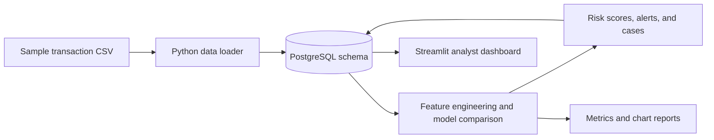
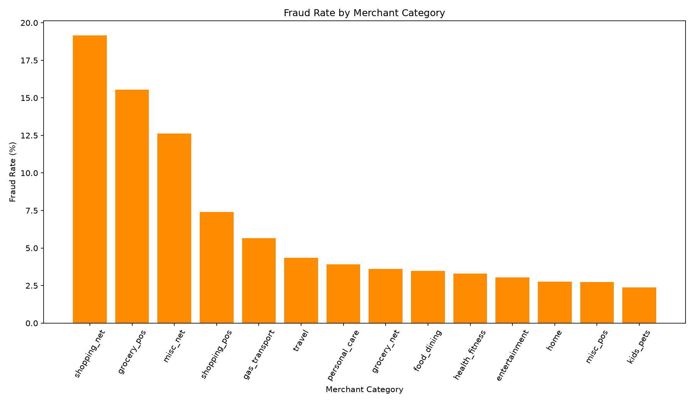
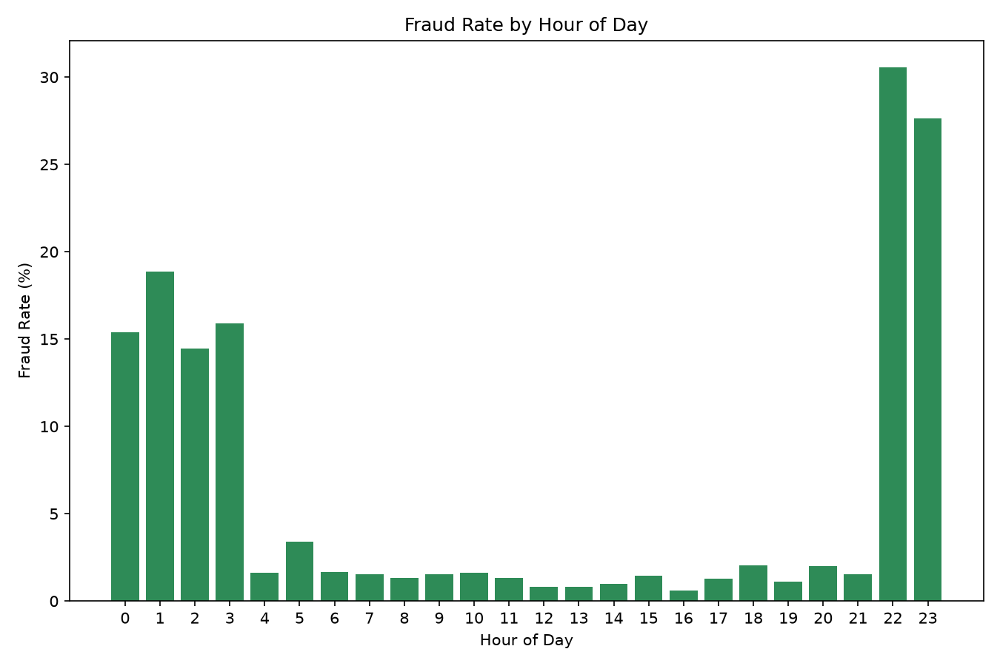
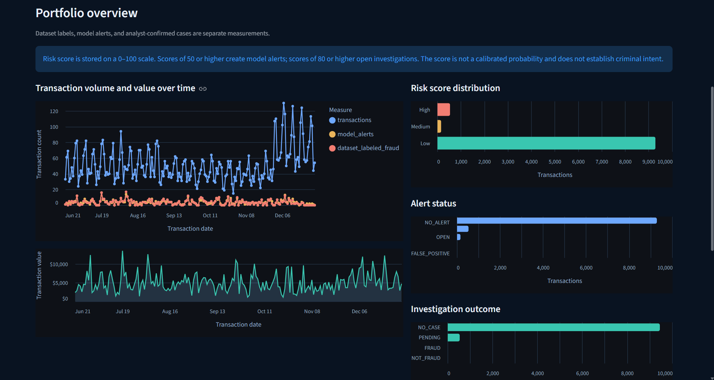
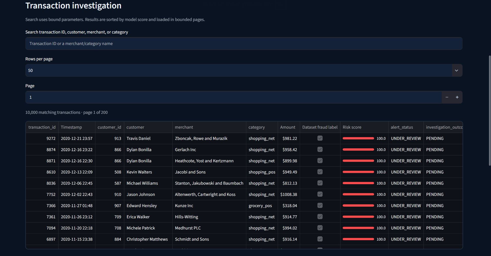
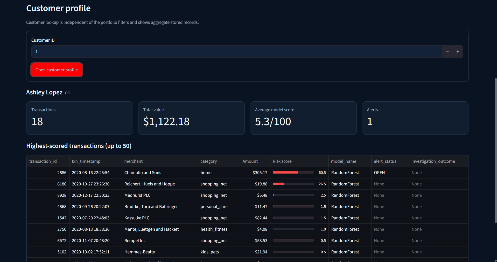
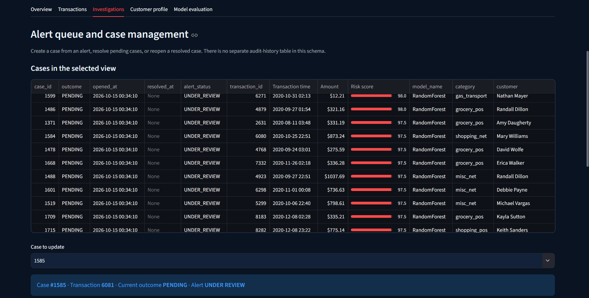
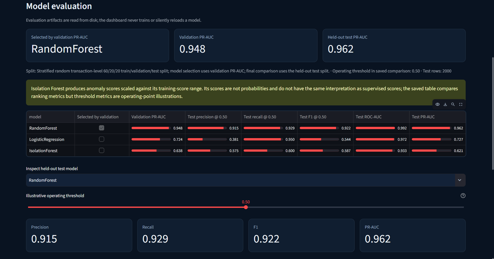
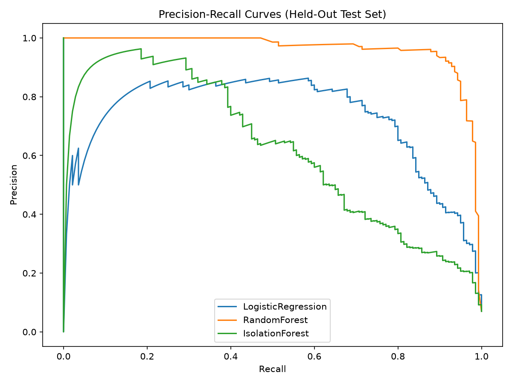
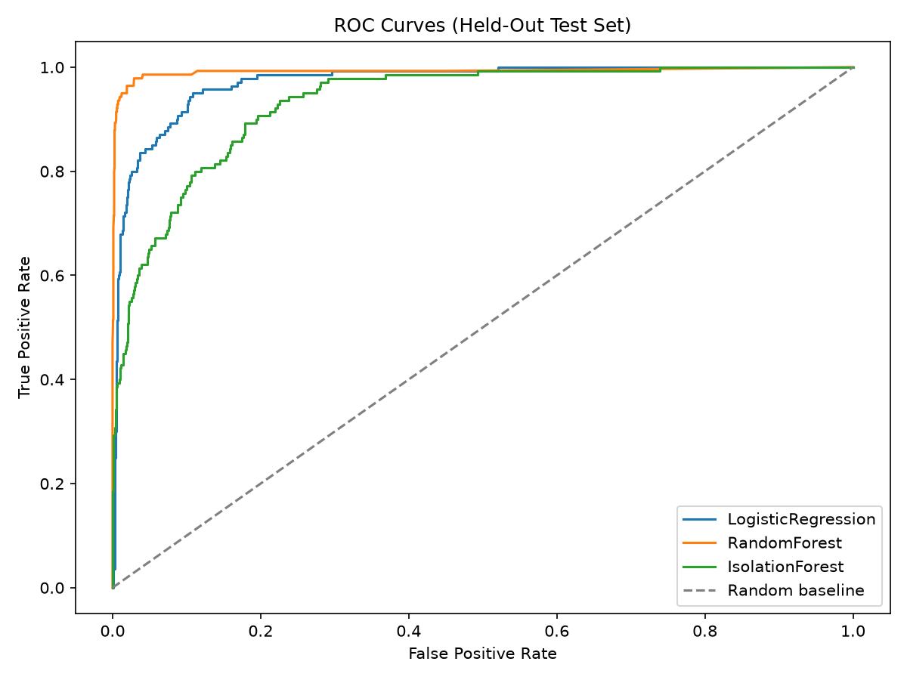

# FinGuard AI

**FinGuard AI** is an end-to-end fraud analytics project built with PostgreSQL, Python, scikit-learn, and Streamlit. It turns a transaction sample into a relational database, compares fraud-scoring models, stores risk scores and investigation cases, and gives an analyst a dashboard to explore and review the results.

The included sample has **10,000 transactions**, including **700 dataset-labeled fraud transactions (7.00%)**. Model reports and charts are generated files; rerun the pipeline after setup to refresh them with the current code.

## Project highlights

- **Relational design:** 12 core PostgreSQL tables with primary and foreign keys, domain constraints, indexes, views, and a function; the advanced SQL setup adds a case-history ledger and triggers.
- **Fraud scoring:** Logistic Regression, Random Forest, and Isolation Forest selected by validation PR-AUC; both transaction-random and customer-disjoint reports are included, with the latter holding out entire customers from the same simulated sample.
- **Investigation workflow:** risk scores create model alerts and high-risk cases; case creation, resolution, and reopening record an analyst-entered name, reason, and outcome transition in a database history ledger. Analyst names are self-reported, not authenticated identities.
- **Analyst dashboard:** shared date, category, amount, score, risk-band, alert, and case-outcome filters; a dark navy operations workspace; paginated transaction search and evidence details; customer profiles; case creation, resolution, and reopening; model evaluation; and safe CSV export.
- **Reproducibility and CI:** deterministic customer-disjoint evaluation, unit tests, and PostgreSQL integration tests run in GitHub Actions against a disposable PostgreSQL 16 service.

## Data flow



## Analytics preview

These charts show recorded sample labels by category and hour. They describe the dataset, not a live fraud feed.





## Portfolio summary

> Built FinGuard AI, a PostgreSQL-backed fraud analytics project that models transaction risk and supports case review. Designed a 12-table relational schema with constraints, indexes, views, a SQL function, and a trigger; implemented a reproducible Python pipeline to compare supervised and unsupervised models; and built a Streamlit dashboard for transaction exploration, investigation outcomes, customer risk profiles, and CSV exports. The transaction-random Random Forest report achieved 0.948 validation PR-AUC and 0.962 held-out test PR-AUC. A second customer-disjoint split selected Random Forest at 0.954 validation PR-AUC and recorded 0.962 held-out test PR-AUC, with 179 customers held out. Both are results on the same simulated sample, not independent validation.

The reports in `outputs/` include a transaction-random split and a supplementary customer-disjoint diagnostic, both refreshed on 2026-10-21 using the current evaluation code. The report-only mode leaves database scores, alerts, and investigations unchanged. The local PowerPoint draft is excluded from GitHub until its screenshot placeholders are resolved. This is a prototype evaluated on one sample dataset, not a production fraud prevention system.

## Dataset and scope

The included 10,000-row CSV is a sample from the [Credit Card Transactions Fraud Detection dataset on Kaggle](https://www.kaggle.com/datasets/kartik2112/fraud-detection), generated with the [Sparkov Data Generation tool](https://github.com/namebrandon/Sparkov_Data_Generation). The source dataset is simulated; its card numbers and identity fields are synthetic. This project uses the sample for coursework and demonstration, and the reported metrics should not be read as expected real-world fraud performance. The project code is MIT licensed; the dataset remains subject to its source terms.

## Database design and query examples

The schema separates customers, accounts, cards, merchants, devices, locations, transactions, loans, payments, scores, alerts, and investigations. Primary and foreign keys model relationships; `CHECK`, `UNIQUE`, and `NOT NULL` constraints protect valid values; views provide category and customer summaries. `advanced_db.sql` adds analyst views, a stable SQL function, triggers that keep a case's resolution timestamp and linked alert status in sync, and an append-only event ledger for case creation, resolution, and reopening. The dashboard supplies a self-reported analyst display name and required reason for these actions; this is traceability, not authentication or tamper-proof auditing. See [ER_DIAGRAM.md](ER_DIAGRAM.md) for the entity relationship diagram.

`queries.sql` is a compact walkthrough of the relational concepts used in the project: multi-table joins, aggregation, a subquery, a window function, loan risk analysis, constraint checks, and an ACID transaction example that rolls back. Run its row-count query to inspect all 12 tables.

### Index evidence

`advanced_db.sql` runs `EXPLAIN ANALYZE` for a merchant-and-time transaction lookup before and after creating a composite index. In a local run on the 10,000-row sample, PostgreSQL used the existing timestamp index and filtered by merchant before the composite index; afterward it used both composite-index conditions. One run reported 0.052 ms before and 0.065 ms after, which is too small and cache-sensitive to claim a speedup. The useful evidence is the plan shape: the composite index satisfies both predicates. Recheck plans and repeated timings on your own PostgreSQL instance and larger data before keeping an index for performance.

## Tech stack

- PostgreSQL for relational storage, constraints, indexes, views, a function, and a trigger.
- Python with pandas, NumPy, scikit-learn, SQLAlchemy, and psycopg2 for loading and ML.
- Matplotlib for saved model reports and Altair for interactive dashboard charts.
- Streamlit for the interactive dashboard.
- SQL and Mermaid for the database demonstrations and ER diagram.

The Streamlit dashboard separates dataset labels, model-generated alerts, and investigator-confirmed cases. Its global filters apply to the overview, transaction results, and case queue. Transaction search is paginated and bounded; its detail panel shows recorded score, model, alert, and case fields without inventing a per-transaction explanation. Case actions require confirmation, use conditional updates, clear cached reads, and synchronize the linked alert through the database trigger.

## Folder structure

```text
dbms/
├── .gitattributes
├── .gitignore
├── .env.example
├── advanced_db.sql
├── app_utils.py
├── dashboard.py
├── dashboard_logic.py
├── ER_DIAGRAM.md
├── FACULTY_QA.md
├── load_data.py
├── LICENSE
├── ml_pipeline.py
├── outputs/
│   ├── evaluation_metadata.json
│   ├── evaluation_predictions.csv
│   ├── model_results.csv
│   └── charts and feature reports
├── PORTFOLIO_GUIDE.md
├── queries.sql
├── requirements-dev.txt
├── requirements.txt
├── schema.sql
├── sparkov_sample_10000.csv
└── tests/
    ├── test_app_utils.py
    ├── test_dashboard_app.py
    ├── test_dashboard_logic.py
    ├── test_loader_safety.py
    ├── test_ml_pipeline.py
    └── test_postgres_integration.py
```

`load_data.py` reads `sparkov_sample_10000.csv` from the project directory, even when the script is launched from another working directory. `.env.example` documents local settings; `.env` is ignored by Git.

## Setup

### 1. Install and start PostgreSQL

Install PostgreSQL for Windows from the official PostgreSQL download page and start the PostgreSQL service. Create a database named `finguard` using pgAdmin or `psql`, for example:

```sql
CREATE DATABASE finguard;
```

### 2. Configure credentials and connection settings

Copy `.env.example` to `.env` and set `PGPASSWORD` to your local PostgreSQL password. The dashboard and ML pipeline also accept `DB_PASSWORD` for compatibility with earlier setup. `.env` is excluded from Git. Never commit real credentials.

Optional connection variables used by the scripts are `PGHOST` (default `localhost`), `PGPORT` (default `5432`), `PGDATABASE` (default `finguard`), and `PGUSER` (default `postgres`). Configure these consistently for all scripts if your local PostgreSQL settings differ.

### 3. Create a Python environment and install packages

From the project folder in PowerShell:

```powershell
py -m venv .venv
.\.venv\Scripts\Activate.ps1
python -m pip install -r requirements.txt
```

Install the optional test dependency with `python -m pip install -r requirements-dev.txt`.

If PowerShell blocks environment activation, use the environment's Python directly, for example:

```powershell
.\.venv\Scripts\python.exe -m pip install -r requirements.txt
```

### 4. Load the dataset

Run this from the project folder:

```powershell
python load_data.py --reset
```

The loader asks you to type `RESET` before it drops and recreates the project tables and views. It will not run without `--reset`; for deliberate non-interactive use, pass both `--reset --yes`. This replaces project data, including scores, alerts, and investigations. Reapply `advanced_db.sql` after a reset.

### 5. Train models and write scores

```powershell
python ml_pipeline.py
```

The script uses stratified 60/20/20 train, validation, and test splits. It selects a model by validation PR-AUC, refits each candidate on train plus validation data, and reports final comparison metrics on the untouched test split. By default, it writes risk scores, alerts, and investigations; selected supervised-model database scores use five-fold stratified out-of-fold probabilities. Charts and CSV reports are saved under `outputs/`.

To refresh only the evaluation CSVs and charts while leaving the database's risk scores, alerts, and investigation cases unchanged, run:

```powershell
python ml_pipeline.py --reports-only
```

### 6. Create the advanced SQL objects and run demonstrations

Using `psql` from the project folder:

```powershell
psql -U postgres -d finguard -f advanced_db.sql
```

Alternatively, open `advanced_db.sql` in pgAdmin's Query Tool and execute its statements in order. The script creates indexes (some names already exist in the base schema), `v_high_risk_transactions`, `v_customer_risk_summary_advanced`, `get_customer_risk()`, a resolution timestamp column, and an investigation trigger. The trigger marks alerts `UNDER_REVIEW` when a case is created, synchronizes outcomes on resolution/reopening, and reconciles alerts linked to existing cases. Its trigger-test update is rolled back at the end. The transaction examples use a temporary table.

### 7. Start the dashboard

```powershell
streamlit run dashboard.py
```

The local dashboard URL printed by Streamlit is normally `http://localhost:8501`. The advanced SQL objects should be installed first because the dashboard queries the high-risk view and customer-risk function.

## Demo walkthrough

1. Show the populated database using the row-count query in `queries.sql` and point out the customer, account, merchant, transaction, and loan entities.
2. Run `SELECT * FROM v_fraud_by_category ORDER BY fraud_pct DESC;`. These are descriptive dataset summaries, not live fraud rates.
3. Run the hour-of-day query from `queries.sql`. The current fraud counts are highest at hour 22 (185) and hour 23 (173).
4. Review the refreshed `outputs/model_results.csv` and `outputs/customer_holdout_results.csv`. Explain that validation PR-AUC selects the model while the separate test set supplies the final comparison. To refresh the artifacts after changing the data or model code, run `ml_pipeline.py --reports-only`; run without that flag only when you intend to replace database scores, alerts, and investigations.
5. Open the confusion-matrix, ROC, precision-recall, feature-importance, and fraud-analysis files in `outputs/`.
6. Run `advanced_db.sql` and show its views, function, indexes, case-history table, demo queries, and rollback-safe trigger example.
7. Start the dashboard. Use the shared date, category, amount, score, risk, alert, and case filters to explore the overview. Open **Transactions** to search by transaction, customer, merchant, or category, page through results, inspect linked evidence, and export the current page as CSV.
8. Open **Customer lookup** and look up a customer ID (for example `1`) to review the aggregate risk summary and highest-scored transactions. **Model performance** shows the saved model comparison and evaluation charts under `outputs/`; regenerate them after changes to the data or pipeline.
9. In **Investigations**, create a case from an unassigned alert, resolve a pending case as `FRAUD` or `NOT_FRAUD`, or reopen a resolved case. Confirm the database update before saving; the trigger synchronizes alert status and resolution time. These actions write to the database, so demonstrate them using a disposable/demo database.

## Dashboard screenshots

The five screenshots below show the real Streamlit dashboard with sample data. They are also stored under `docs/screenshots/`. The live app was not opened in a browser during this review; the checked-in Streamlit AppTest covers the recoverable database-connection failure path. Use a disposable database for any case action, and keep credentials and terminal details out of future captures.

### Overview



### Transaction investigation



### Customer profile



### Investigations and cases



### Model evaluation



Saved evaluation curves are available as report charts:





The five dashboard screenshots predate the latest case-history and customer-held-out panels. They are authentic earlier captures; reopen the dashboard after installing `advanced_db.sql` and replace them with fresh captures to show the new panels.

## Tests

Install development dependencies and run the unit suite:

```powershell
python -m pip install -r requirements-dev.txt
python -m pytest -q
```

The unit tests cover CSV formula-injection protection, feature preparation and split boundaries, shared filter construction, risk-band thresholds, operating-point metrics, safe database-error messaging, and loader reset safeguards. PostgreSQL integration tests are skipped locally unless `TEST_DATABASE_URL` points to a disposable test database. GitHub Actions provisions a dedicated `finguard_test` PostgreSQL 16 service, runs both unit and integration tests, and destroys the service at job end. The integration tests create a uniquely named schema and roll back test rows. Set that variable in the current shell to include those checks; do not point it at a database containing data you need.

## Troubleshooting

- **Connection failed:** make sure PostgreSQL is running and `PGHOST`, `PGPORT`, `PGDATABASE`, `PGUSER`, and `PGPASSWORD` in `.env` match your local server. The dashboard displays a generic recovery message and keeps connection details out of the UI.
- **Missing customer-risk function or high-risk view:** run `advanced_db.sql` after the base schema and pipeline setup. A loader reset drops advanced objects, so run the advanced SQL setup again after a reset.
- **Missing case-history table / database query error:** apply `advanced_db.sql` to the same database configured in `.env`; do not reset or reload the dataset. The dashboard now identifies this specific missing-table error and shows the migration step.
- **No model report or threshold curves:** run `python ml_pipeline.py --reports-only`. This reads the database and refreshes evaluation files without replacing risk scores, alerts, or investigations.
- **No transactions match:** reset the global filters in the sidebar or use the all-dates/all-categories defaults.

## Notes and limitations

- `risk_score.score_value` and `fraud_alert.risk_score` use a 0–100 scale. `risk_level` is derived by the pipeline/dashboard and is not a base-table column.
- The base schema defines `investigation.outcome` (`PENDING`, `FRAUD`, `NOT_FRAUD`), not an investigation `status` column. `advanced_db.sql` adds `resolved_at`, synchronizes linked alert status, and installs `investigation_history` for case creation, resolution, and reopening. The event reason and display name are provided by the dashboard; no user authentication is implemented.
- The pipeline uses out-of-fold model predictions for the supervised model's database scores. Customer-level aggregates calculated across the full dataset have been removed to avoid sharing information across folds. Model choice uses validation data separate from the final test split. The main report uses a random transaction-level split. A supplementary stratified customer-disjoint split keeps each customer in exactly one partition and provides a diagnostic for unseen customers within this same simulated sample; it does not establish performance on an independent or real-world dataset.
- No deployment, production monitoring, or independent evaluation on a second dataset is documented in this project.
- The evaluation dashboard shows the random split and customer-disjoint diagnostic from saved artifacts. Its operating-point slider is an analytical view of saved held-out predictions; changing it does not rewrite database alerts. The database alert threshold remains 0.50 and investigation threshold remains 0.80 in normalized score units.
- Generated account, device, income, and loan attributes are synthetic; they support the DBMS demonstration and are not observations from the source CSV.
- PostgreSQL integration checks require an explicitly configured test connection; the standard unit suite does not modify a database.
